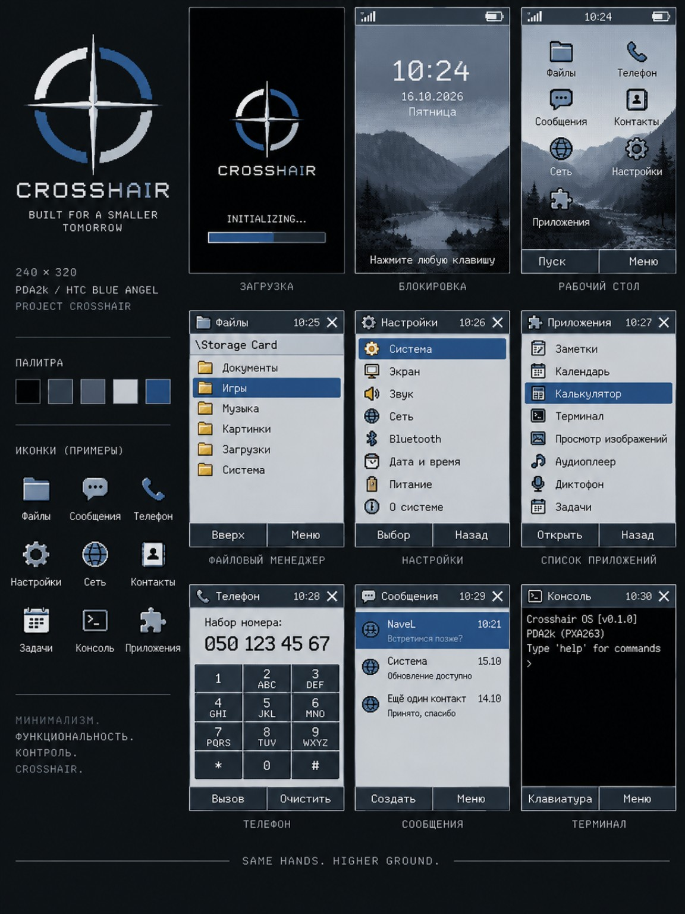

# Crosshair UI Design System 0.1

**Integration verified:** Wave004 actually executes this shared renderer in the ARMv5TE guest, with101 logical events and23 exact guest/host/QEMU pixel comparisons. [Execution, RAM and limits](../reports/WAVE_004.md). Physical ATI/display/input behavior remains untested.

Implemented for the shared 240×320 RGB565 software renderer in Wave 004. The direction is a compact, practical evolution of a Pocket PC interface: gray surfaces, a blue application header, clear keyboard focus, short Russian labels and persistent bottom actions. Wave004 originally followed the written direction and Crosshair's existing gray-blue palette. On 16.10.2026 the owner supplied and approved the visual reference below as the primary artistic direction for the next functional Crosshair Shell 0.1; that approval does not change the historical Wave004 execution results or claim that the pictured shell is already implemented.

The [theme](../ui/src/theme.rs) supplies the shared exact colors and Wave004 diagnostic layout. [Components](../ui/src/components.rs) and `AppsScreen::render` preserve those constants. The new [Shell composition](../shell/src/render.rs) reuses that Surface/font/component/theme foundation with its own bounded Desktop/application geometry and two defined palette roles. Host fixtures and ARM callers share their respective renderer/state code; there is no separately drawn host mockup. The existing surface renderer, eleven primitive tests, font bytes and [font license](../ui/third_party/cozette/LICENSE) remain unchanged. See [diagnostic navigation](UI_NAVIGATION.md), [Shell navigation](SHELL_NAVIGATION.md) and [screens](UI_SCREENS.md) for behavior and implementation status.

## Approved visual reference for Crosshair Shell 0.1

| Provenance | Recorded fact |
| --- | --- |
| Source and approval | User-provided image, inspected and approved by the project owner in chat on 16.10.2026 for the next functional Crosshair Shell 0.1 |
| Versioned original | [crosshair-ui-reference-2026-10-16.png](design/crosshair-ui-reference-2026-10-16.png), 1152×1536 PNG, 1499273 bytes |
| SHA-256 | `cf7aecb9a0ea4b288a8008a2b26c4b33ddca48a060c2d39fc7c60088c8ff8a07` |
| Preservation | Original bytes copied unchanged; source and repository copy have identical SHA-256. No image editing, resizing or palette conversion was performed |
| Rights/publication | Owner approval records its use as a project reference and versioned repository asset. No separate image copyright licence was supplied or inferred; the MIT licence for Crosshair's own code does not automatically relicense external artwork. External publication of this asset is not performed by this documentation update |

The reference governs the shell's **artistic direction**, not a pixel-for-pixel copy or a replacement rendering engine. Wave007 carries forward the cold gray-blue palette, dark system bars, compact Pocket PC headers and lists, persistent bottom softkeys, uniform icon language and clear selection/focus. Wave007 initially presented an application grid on Desktop. Wave007.1 refines Desktop into a wallpaper workspace with small functional shortcuts; the complete application catalog belongs to Start/Launcher, and Today remains a separate screen. Settings, Launcher, About and Diagnostics share these rules. Future Files, Phone, Messages and Console must retain them as their actual capabilities become available. The original exact theme tokens below remain unchanged.

Shell 0.1 is implemented as functional graphics on the existing shared renderer: real keyboard logical events, bounded screen/application state, menu/dialog transitions and theme choice drive the pixels. It adapts the concept to 240×320 RGB565, the existing Cozette subset and the explicit [User/kernel memory contract](SHELL_ARCHITECTURE.md). [Tabler Icons is the primary system-icon source](UI_ASSET_SYSTEM.md): a pinned18-icon MIT subset is converted at build time into12/16/24px monochrome masks and tinted by the theme; no reference-image pixels are copied into it. Wave007.1 adds bounded logical single-tap hit testing and a static wallpaper composed into the same framebuffer; physical stylus hardware/calibration remain unimplemented. The wallpaper must preserve text/selection contrast and bounded redraw cost. Opaque shortcut captions and icon backing preserve contrast; neither the image reference nor runtime PNG/SVG processing becomes a rendering engine.

Pictured clocks, radio/battery bars, phone/messages, update notices and application entries remain concept content. They do not establish working time, modem, network, power or storage services. Shell Today explicitly labels unavailable services; Diagnostics uses the kernel's actual supplied snapshot and actual local UI counters. A dialler drawing must never claim a successful call. Wave006 remains its separate task-runtime regression; Wave007 provides the new [User Mode Shell and execution evidence](../reports/WAVE_007.md).

## Implemented Shell palette and composition

The [Shell renderer](../shell/src/render.rs) uses `SYSTEM` for a single24-pixel top/system bar and24-pixel bottom softkeys, plus existing shared selection/button components for focus, menus and confirmation. Start and application Back are compact real controls in the same top bar; there is no second oversized Desktop title strip. Classic body roles are `BACKGROUND/SURFACE/INK/MUTED`; night roles are `SYSTEM/HEADER/WHITE/SELECTED`. The actual setting switches these body roles in memory and reset/cancel has explicit behavior; it does not modify the historical `ui::theme` constants or persist a configuration file.

Desktop uses three72×58 shortcut targets at x8, y42/108/174, each with a24×24 Tabler mask, a small icon backing and an opaque bounded caption. They open Today, Settings and Diagnostics, leaving the remaining workspace free. Start opens Launcher, which owns the full four-entry catalog, compact28px list rows and a visible bounded query. Geometry is shared by [rendering and hit testing](../shell/src/geometry.rs). Informational screens keep a keyboard-reachable Back softkey; an empty filtered Launcher keeps search focus. Menus and the theme-reset dialog are genuine bounded overlays. The geometry/color tables below continue to specify the preserved Wave004 diagnostic AppsScreen; they are not a claim that Shell's current workspace uses diagnostic list-row coordinates. Full Shell navigation is documented [separately](SHELL_NAVIGATION.md).

## Color tokens

RGB565 numbers are normative. The RGB888 column shows the bit-expanded preview produced by the PNG encoder; it is not a second palette. Pixel byte order belongs to the backend; fixtures use little-endian RGB565.

| Token | RGB565 | Expanded RGB888 | Use |
| --- | --- | --- | --- |
| BACKGROUND | `0xe73c` | `#e7e7e7` | Screen canvas and row gaps |
| SURFACE | `0xf79e` | `#f7f3f7` | Ordinary rows, search and list status |
| INK / SYSTEM | `0x1946` | `#182831` | Text / compact system strip |
| MUTED | `0x5b4e` | `#5a6973` | Search label and explanatory text |
| HEADER | `0x2a4b` | `#29495a` | Application header |
| SELECTED | `0xc6fb` | `#c6dfde` | Selected item, including inactive selection |
| FOCUS | `0x21e8` | `#213c42` | Two-pixel active keyboard border |
| EDGE | `0x9cf3` | `#9c9e9c` | Unfocused button outline |
| SOFTKEY | `0xdedb` | `#dedbde` | Bottom action background |
| WHITE | `0xffff` | `#ffffff` | Header and system-strip text |
| SCROLL_TRACK | `0xc638` | `#c6c7c6` | Actual list scroll track |
| SCROLL_THUMB | `0x7452` | `#738a94` | Actual list scroll position |
| TEST_RED / GREEN / BLUE | `0xf800` / `0x07e0` / `0x001f` | RGB primaries | Diagnostic preview only |
| DISABLED | `0x5b4e` | `#5a6973` | Alias of MUTED for future disabled labels |
| DISABLED_SURFACE | `0xe73c` | `#e7e7e7` | Alias of BACKGROUND for future disabled controls |
| PRESSED | `0xc6fb` | `#c6dfde` | Alias of SELECTED for future transient press feedback |
| ACTIVE | `0x21e8` | `#213c42` | Alias of FOCUS for active foreground/border |
| WARNING | `0xfd20` | `#ffa600` | Warning accent/fill; use INK text on a warning fill |
| ERROR | `0xf986` | `#ff3031` | Error accent/fill; use INK text on an error fill |

`SYSTEM_ICON=WHITE`, `SYSTEM_ICON_DISABLED=EDGE`, `SYSTEM_ICON_ACTIVE=SELECTED`, `SYSTEM_ICON_WARNING=WARNING` and `SYSTEM_ICON_ERROR=ERROR` are aliases for small monochrome icon foregrounds against SYSTEM. Normal body text stays INK; bright warning/error accents are not a replacement for readable text on a light surface. The state roles are centralized specifications: disabled/pressed control behavior and system-status icons are **planned**, not implemented by the current Apps screen. Disabled controls must reject activation, keep their label visible and avoid presenting a normal active border; a pressed control returns to its ordinary/focused role on release or cancellation. That behavior needs widget-state tests when those widgets are added. A color token alone does not implement it.

Colors do not encode a fabricated battery level, radio signal, network state or successful operation. Focus is also identified by its border; selection is a persistent fill. There are no gradients, shadows, alpha surfaces, animations or heap-backed style objects.

## Geometry and typography

All rectangles below use half-open coordinates; the right/bottom edge is excluded. This fixed layout does not scale or reflow. Smaller validated surfaces clip it safely.

| Region | Geometry in pixels |
| --- | --- |
| Screen | x `[0,240)`, y `[0,320)` |
| System strip | x `[0,240)`, y `[0,16)`; text top 1, left 4; static right label x 208 |
| Application header | x `[0,240)`, y `[16,44)`; horizontal text padding 8 |
| List search strip | x `[0,240)`, y `[44,64)`; text top 48; label x 6, filter x 50 |
| List rows | x `[6,230)`; first y 68; pitch 26, drawn height 24; eight visible rows |
| Last row | y `[250,274)`; two-pixel row gaps expose the background |
| Scroll track | x `[234,237)`, y `[68,276)`; shown only when more than eight matches exist |
| List status | x `[0,240)`, y `[280,296)`; text top 281; selected/total at x 6/36, slash x 24, hint x 132 |
| Bottom actions | y `[296,320)`; left x `[0,120)`, right x `[120,240)` |
| Menu rows | x `[6,230)`; first y 58; pitch 30, height 26 |
| Preview | Name top 58; caption top 80; content origin `(12,106)`; geometry preview 216×70 |

The thumb height is `max(8, 208 × 8 / match_count)` clipped to its track. Its position uses `scroll / (match_count − 8)`. Calculations are integer-only. The indicator therefore reflects the real filter/scroll state; no static illustration pretends to be a working control.

Typography is the existing [Cozette subset](../ui/third_party/cozette/PROVENANCE.json): 163 glyphs, all Russian letters including Ё/ё, Й/й, Ъ/ъ and Ь/ь, ASCII, em dash and replacement glyph. Advance is six pixels, maximum ink width eight, ink height thirteen and line advance fourteen. Components reserve the two-pixel ink overhang and truncate before ink would cross their bounds. Component labels stop at newline; the lower-level text primitive supports explicit newlines. There is one bitmap font and no antialiasing, scaling or fallback font allocation.

Component labels have four-pixel inset padding; the application title uses eight pixels horizontally. Selection/focus painting and text stay within the component rectangle. Negative and extreme coordinates are handled by the existing checked surface clipping. A long label is truncated without an invented ellipsis glyph or horizontal marquee.

The following compact control specifications are also exact constants in `theme::layout`. The constants alone do not create an input editor, dialog manager, draggable scrollbar or hit-testing implementation. The separate Shell now implements its own bounded theme-reset dialog and [Tabler icon catalog](UI_ASSET_SYSTEM.md); hardware-status service integration remains absent.

| Control/token contract | Exact dimensions | Status |
| --- | --- | --- |
| Border / focus / gap | `BORDER_WIDTH=1`, `FOCUS_WIDTH=2`, `CONTROL_GAP=4` | Existing one-pixel outlines/two-pixel focus; shared future tokens |
| Button | Height 24, minimum width 48, internal padding 4; reserve eight-pixel last-glyph ink | Existing renderer; min-width policy and pressed/disabled interaction planned |
| Single-line input | Width 224, height 24, padding 4; usable inner width 216/height16 | Planned editor; current search strip is a separate 20-pixel display/filter region |
| System/small icon | 12×12, padding2 in a 16-pixel strip, text gap4 | Monochrome Tabler masks implemented at12/16/24px; diagnostic strip/hardware-status icons are not drawn without real status services |
| Scrollbar | Existing visual width3, minimum thumb8; planned hit region x `[232,240)` width8 | Position rendering implemented; stylus dragging/hit region planned |
| Dialog | x12/y64, width216/height184, padding8; remains above softkeys | Planned modal surface, not an implemented overlay |
| Dialog header/body/footer | Header24, footer32, eight 14-pixel body lines after vertical padding; inner width200 | Planned fixed layout; overflow must scroll or truncate explicitly |
| Dialog actions | Two 96×24 buttons separated by8; horizontal padding8, footer top/bottom padding4 (`BUTTON_PADDING`) | Planned; default/cancel action must be explicit and keyboard reachable |

A generic input's 24-pixel height permits thirteen-pixel text plus four pixels above/below. The dialog's body budget is 112 pixels; its geometry cannot expand beyond the fixed screen to fit content. Padding, icon and hit-region numbers are software pixels, not measured millimetres or evidence of physical stylus accuracy. Dialog focus must be contained while open and restored on close; implementation must add bounded state and cancel/validation tests before claiming modal support.

## Time, date and status policy

The implemented strip reads **«Система» / «Тест»**. Clock, date, battery, charging and radio status are not implemented or synthesized.

For a future clock, the specified display form is 24-hour `HH:MM`, zero padded; a date uses `DD.MM.YYYY`. Machine-readable records should use an explicit date/time and timezone rather than ambiguous locale strings. These are formatting requirements, not a claim that a real-time clock, timezone database or formatter already exists. The current four-character right label is not a ready clock widget; adding a five-character clock requires its own padded geometry, trusted time source, invalid/unset state and minute-boundary refresh tests. Unknown measurements must not be replaced with convincing status icons.

A real font-rendering test draws `23:59`, `16.10.2026` and `ЁЙЪЬёйъь` with the existing font. It checks thirteen-row bounds, six-pixel advance reservations, identical time-label masks in ACTIVE/DISABLED ink, untouched row padding and outer sentinels. Five-character time reserves32 ink pixels, ten-character date62 and eight Cyrillic scalars50. This proves label fit and color roles; it does not implement calendar validation, a formatter or a time source.

## Preserved diagnostic memory and integration

The library remains dependency-free `no_std` with `forbid(unsafe_code)`, no allocation, floating point, MMIO or second framebuffer. The theme is compile-time constants and adds no mutable theme owner. The measured state profile is unchanged:

| Object | Host x86_64 Darwin | ARMv5TE |
| --- | ---: | ---: |
| AppsScreen | 76 bytes | 76 bytes |
| Eight-event InputQueue | 36 bytes | 36 bytes |
| Existing Surface handle | 112 bytes | 88 bytes |
| One full framebuffer | 153600 bytes | 153600 bytes |
| State + queue + surface, excluding pixels | 224 bytes | 200 bytes |

Sizes come from the actual host/ARM compile-only object probe, not assumed pointer widths. They are persistent object sizes, not peak stack measurements. The caller owns framebuffer RAM/BSS; a full framebuffer must not be placed on the small kernel stack. The host example allocates one framebuffer and JSON strings using `std`, outside the library's zero-heap contract. Fixture constants and catalog/code placement are not included in the writable-state budget; their materialization and peak stack/code size require separate target measurements.

Rendering currently repaints the full screen on a relevant state change. Dirty rectangles still clear only after every `present` callback succeeds, retaining all regions on failure. The backend must finish consuming pixels before returning success; asynchronous DMA requires a completion contract. Driver cache maintenance, transfer order, physical LCD timing and input interrupt synchronization remain outside the theme.

## Preserved Wave004 validation and deliberate golden change

`scripts/test-ui.sh` passed **24 host tests**, the existing 20000 deterministic stress operations, actual ARMv5TE/EABI5/no-hard-float code-object inspection, target layout extraction and pinned-font regeneration. The additional role/geometry and real date/time/Cyrillic label tests do not change screen rendering. The eleven primitive tests and UI 0.1 raw565 golden `5431880093368634183` are unchanged. The Apps screen golden deliberately changes from UI 0.2's `10739668449275078947` to **`6602604234790396534`**, reflecting this theme and geometry change, with the same logical input trace.

The script produces twenty raw565/PNG captures from the shared canonical and boundary scenarios; selected final, menu, full-filter/empty-result and text-preview PNGs were actually inspected at 240×320. Generated files remain ignored under `target/artifacts/ui/design-system/`; no screenshot is presented as a physical PDA photograph. Host/ARM parity and guest execution are recorded separately by the Wave 004 integration report when actually tested.

Wave007 adds [11 Shell state/render tests](../shell/src/tests.rs) covering navigation/history, menus, dialog/theme, text input, clipping/canaries, dirty/present failure, runtime validity and20,000 bounded burst actions, plus [two catalog/drawing tests](../shell/src/icons.rs) and [six SVG/binding tests](../shell/tools/test_generate_icons.py). [The replay exporter](../shell/examples/export.rs) writes actual240×320 PNG/raw565 and named Snapshot fields from the shared Shell code, accepting captured kernel metrics per event. Shell persistent size, ARM User allocations, framebuffer and privilege-boundary execution are measured separately in [Wave007](../reports/WAVE_007.md); they do not replace or silently revise the diagnostic object's table above.

Wave007.1 intentionally changes Shell keyframe pixels and its Desktop keyboard trace; the Wave004 primitive/font/diagnostic theme tokens and recorded historical captures remain unchanged. Its [wallpaper source](../shell/assets/wallpaper/crosshair-mist-source.png) was created for the project as separate artwork, with the approved reference used only as artistic direction. [Provenance and packing](../shell/assets/wallpaper/PROVENANCE.json) bind the original image, prompt,16-color RGB565 transformation and generated row-RLE. The guest stores15533B of wallpaper payload (14827B runs,642B row offsets,64B classic/night palettes), with scalar decoding directly into the existing framebuffer. This payload is distinct from total linked ROM size and measured mutable Shell state.

The current host suite passes20 Rust tests, including five additional tap/partial-render scenarios and two wallpaper-format/clipping tests alongside preserved functional/catalog tests. Logical tap input is an experimental host-to-ARM adapter and does not establish a physical PDA touchscreen driver. Wallpaper focus redraws and menu overlays use bounded dirty regions; exact firmware/RAM/update counts belong to the measured execution report, while the Present broker still publishes one complete153600B frame per successful render.
