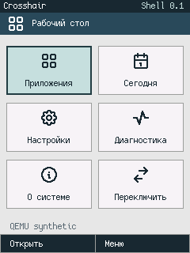
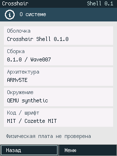
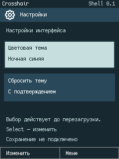

# Wave007 — Crosshair Shell0.1

16.10.2026, принятая база `6b003d1` (Wave006, опубликована в `main` перед началом реализации). **Реализовано и проверено в ARM TCG:** функциональная графическая оболочка в отдельной User Mode задаче, управляемая событиями, с Desktop, отдельным Today, Launcher и тремя системными экранами. Пользователь открывает приложение, возвращается назад и продолжает сеанс без перезагрузки. Вторая изолированная User-задача непрерывно вычисляет; Shell вытесняется таймером и блокируется при отсутствии ввода. Ни renderer, ни прежние QEMU models не заменялись.

**Живой сеанс macOS:** `scripts/run-crosshair-gui.sh`. Окно показывает свежие кадры настоящей консоли QEMU; ввод MacBook проходит native adapter → существующая synthetic FIFO → kernel queue → User Shell. Графика, навигация и приложения исполняются в ARM-госте, host не содержит Shell state/rendering. Normal сеанс остаётся открытым до закрытия окна/Cmd-Q; headless-тесты сохранены. [Зависимости и клавиши](../BUILDING.md), [архитектура](../docs/SHELL_ARCHITECTURE.md), [навигация](../docs/SHELL_NAVIGATION.md).

## Исходное состояние и границы

[Wave006](WAVE_006.md) подтвердил полный80B User Context,144B Task, отдельные L1/L2, timer preemption, bounded Copy и fault isolation. Это static runtime, без app loader, reusable memory lifecycle, generic IPC или display API. Его exact suite повторён до реализации. Новый Shell использует прежний Assembly context return, Task layout и scheduling policy; исходники принятого guest и прежние reports сохранены. Ограничения caches/CPU260 proxy/ARMv5 XN остаются.

[Утверждённый reference](../docs/UI_DESIGN_SYSTEM.md#approved-visual-reference-for-crosshair-shell-01) задаёт серо-синюю палитру, тёмные панели, Pocket PC geometry, icon grid и нижние действия. Применены существующие Surface/RGB565/dirty rectangles/Cozette/theme/components; системные icons взяты из небольшого закреплённого поднабора Tabler MIT и преобразованы в theme-tinted masks при сборке. Обои не являются зависимостью. Часы/связь/батарея явно недоступны, фиктивных процентов, сигналов, пользовательских сообщений и текущего времени нет.

## Что исполняется

| Часть | Реализация и статус |
|---|---|
| [shell/](../shell/src/lib.rs) | Самостоятельная `no_std`, `forbid(unsafe_code)` state/render library; используется и User ARM, и host oracle |
| [shell_user.rs](../src/shell_user.rs) | Отдельно linked User ELF; создаёт Shell/Surface, получает metrics/events, рисует один свой framebuffer, вызывает SVC |
| [shell.rs](../src/shell.rs) | Привилегированные bounded graphics/metrics/events brokers, queue, timer wiring и lifetime; не выполняет Shell renderer |
| [memory.rs](../src/shell_runtime/memory.rs) | Раздельные page tables, default-deny User aliases, MMU switches; старый Wave006 module не правился |
| [tasks_entry.S](../src/arch/tasks_entry.S), [scheduler](../src/task_runtime/scheduler.rs) | Повторно использованные контекст/политика Wave006; без nested IRQ |
| [native viewer](../tools/crosshair_gui.swift), [adapter](../tools/run_shell.py) | Host frontend только blit фактического QMP frame и key→FIFO; не имитация ОС средствами macOS |

Desktop — сетка реальных действий: приложения, Today, настройки, диагностика, About и переключение уже открытых экранов. Launcher содержит только4 builtin: About, Diagnostics, Settings, Today; поиск ограничен16 символами, поддерживает кириллицу/латиницу и Backspace. Back сначала очищает поиск, затем восстанавливает предыдущий экран; меню закрывается с прежним focus/selection. Home, Select, Menu, стрелки, softkeys и screen task switch работают через прежние logical Events плюс4 reserved PUA intents, без PDA scan codes.

About показывает фактически собранную версию `0.1.0 / Wave007`, ARMv5TE и `QEMU synthetic`. Diagnostics использует kernel-снимок ticks/switches/task states/allocated RAM/events/overflow. Settings действительно переключает Classic/Night и предлагает reset-confirmation dialog; выбор сохраняется при переходах, сбрасывается при QEMU reset и явно обозначен как volatile. Today показывает только доступные counters и честные unavailable service labels. Это функциональные builtin-экраны **внутри Shell process**, а не4 независимых исполняемых User-приложения; их выделение оставлено следующему этапу.





## Адресные пространства, ABI и ожидание

Все адреса далее — **guest VA/PA synthetic E2B/display-test**, не безопасная карта RAM PDA2k. [Linker kernel](../link/shell.ld), [linker User](../link/shell-user.ld), [MMU](../src/shell_runtime/memory.rs).

| Allocation / VA | Backing PA | User доступ |
|---|---|---|
| Busy code/data/stack по прежним VA `01000000/01001000/01003000` | `a0200000/a0201000/a0203000` | RO/RW/RW, guard `01002000` отсутствует |
| Shell code `[01000000,01010000)` | `[a0400000,a0410000)` | AP2 RO; только в Shell L1/L2 |
| Shell data `[01010000,0103f000)` | `[a0410000,a043f000)` | AP3 RW, включая единственный guarded framebuffer |
| Shell guard `[0103f000,01040000)` | Нет mapping | Translation fault |
| Shell stack `[01040000,01048000)` | `[a0440000,a0448000)` | AP3 RW, initial SP=`01048000` |

Одинаковые code VA двух задач выбирают разные физические bytes. Kernel/vectors/tables/stacks, все RAM identity aliases и MMIO (включая display/input section `10000000`) имеют AP1. DACR1 Client, SCTLR79, PID0; переключение TTBR/full TLBI/cache-off path сохранены. ARMv5 RW pages остаются executable, современный XN не заявляется. Slots/pages не освобождаются и не переиспользуются.

ARM `svc #0`/r7 разрешён только из своего mapped RO ARM code window; Thumb/data/stack origins завершают задачу. Exit0, Copy1 и Yield2 сохраняют значения/семантику; Copy ограничен64B собственного data range. Новые операции доступны только kernel-owned Shell role (task index1/id2):

| r7 | ABI и проверка |
|---|---|
| 3 Present | r0=`01010040`, r1=153600B, r2=packed x/y=0, r3=packed width/height=`014000f0`. Принимается только целый240×320 frame; размер, форма, адрес, alignment/full data ownership проверены до MMIO |
| 4 Metrics | r0=aligned pointer в своей data allocation, r1=48B; bounded copy-out версионированного RuntimeInfo, snapshot counts вычислен до mutable Task borrow |
| 5 WaitEvent | r0–r3=0; возвращает wire event либо блокирует задачу в Waiting4 до события |

Ошибки `-EPERM=-1`, `-EFAULT=-14`, `-EINVAL=-22`, `-ENOSYS=-38`; произвольные MMIO, kernel pointer, page table, чужой framebuffer и privileged CPSR интерфейсом не выдаются. Present читает **один** User buffer через privileged PA alias, пока User остановлен в SVC; unchanged QEMU backend синхронно копирует его в свою host console surface. Второго guest framebuffer нет. Размер/координаты не расширяются до непроверенной region API. General app/display capabilities, asynchronous IPC и частичный backend present не реализованы.

Hardware FIFO8 → kernel ring4, bounded drain максимум8 за проход; при переполнении учитываются tail drops. WaitEvent получает queued event либо сохраняет полный контекст и блокирует Shell. Timer каждые36864 virtual ticks опрашивает input, будит Shell и вызывает прежнюю round-robin policy; нет Shell polling/render loop без событий. Kernel handlers IRQ/FIQ masked; в User IRQ enabled/FIQ masked. Если Busy faulted, при пустой очереди используется настоящий privileged System Idle Context с4KiB stack и включённым timer IRQ. Только точный Idle PC/mode/SP допускает privileged-origin IRQ; следующий event будит Shell. Это не аппаратный sleep/PXA power management.

## Исполняемые проверки

`scripts/test-wave007.sh` запускает всю прежнюю цепочку Wave006, host Shell tests, новую ARM integration и на macOS native adapter tests. [Журнал](wave007/all-tests.log), [внешний ARM oracle](../tools/smoke_shell.py), [протокол](wave007/shell/result.json), [freshness validation](wave007/validation.json). UART не выбирает PASS.

Новый ARM suite: **4 boots**, три QMP reset, **140 admitted events**, **47 exact host/ARM/QEMU pixel comparisons**. Каждый event записывает User Snapshot16 words и фактический RuntimeInfo12 words в bounded64-entry trace. Host replay использует те же event+metrics, сравнивает все state words; ключевые raw RGB565, PNG и настоящие QMP console pixels совпадают точно. Перед reset host портит BSS/data/stack, проверяет свежий Desktop/theme и counters, а не старый snapshot.

| Boot | Проверенный результат |
|---|---|
| canonical,44 events | Desktop→Launcher→About→Back/Home; Settings/theme/dialog, Today/Diagnostics, system/context menu, task switch, кириллический поиск и Enter |
| burst-reset,48 | Быстрые batch events, восстановление focus, hardware FIFO rejects2 и kernel queue drops4; admitted order/state/frames проверены |
| fault-reset,44 | Busy после настоящих preemptions выполняет ARM UDF и остаётся Faulted; Shell продолжает весь сеанс, ждёт в System Idle и просыпается |
| role-reset,4 | Другая User-задача реально вызывает Present/Metrics/WaitEvent и получает три `-EPERM`; затем продолжает Busy computation, Shell работает |

Shell startup выполнил11 отрицательных API probes (kernel/wrap pointer, неправильные framebuffer length/geometry, Metrics size/ptr, unknown number, Copy code pointer/cap) и настоящий Yield. Host проверил exact errno, отсутствие раннего PRESENT, guards, все L1/L2 descriptors, User code bytes, banked exception state и кадры. В positive case Busy loop без SVC реально продвигается, пока Shell Waiting; при ожидании число frames/events не растёт. В fault case подтверждены UNDEF opcode/SPSR и Idle→IRQ→Shell return. Независимый статический review проверил pointer/lifetime/alias/MMU/Idle boundaries, не является полным security scan.

**Host:**13 Rust tests:11 navigation/search/menu/dialog/focus/bounds/stress и2 catalog/tint/clipping/canary checks; дополнительно6 Python SVG/source-binding tests и полная повторная растеризация54 masks закреплёнными tools. Общий renderer Wave004/UI regressions сохранён. **Native headless pipeline:** bounded PPM parser и повреждённый ввод, Unicode/key mapping, несколько key lines одним OS write без зависания в TextIO buffering,6 настоящих ARM events. **Visible NSWindow test:** окно действительно открыто; F1/Enter/Escape/Home опубликованы как NSEvents через обычный AppKit routing, backend прочитал фактические ARM screens `Launcher→About→Launcher→Desktop`, окно корректно закрыто. Это автоматизированный оконный тест, не утверждение о ручной аппаратной проверке всех клавиш владельцем. Normal GUI не содержит таймера автозавершения.

Прежние Boot/E1/E2A/E2B/UI/Wave004/Wave005/Wave006 tests и bytes проверены отдельно. E1 по-прежнему сохраняет записанное model reset limitation; Wave006 unused-constant warning не скрыт. Физические PDA2k LCD/input/скорость/изоляция не проверялись.

## Измеренная память

### UI Asset System: Tabler

По дополнению владельца основной источник системных значков — [Tabler Icons](https://github.com/tabler/tabler-icons/tree/a4ce1404bc6d24d3c365afe7b258d6bf6f48d62d), закреплён commit `a4ce1404bc6d24d3c365afe7b258d6bf6f48d62d`. В [shell/assets/tabler](../shell/assets/tabler/PROVENANCE.json) сохранены18 исходных SVG (9251B), upstream MIT LICENSE, оригинальные hashes, stable IDs и host-tool provenance. Код проекта не заменяет лицензию автора иконок.

[Build-time generator](../shell/tools/generate_icons.py) создаёт54 одноцветные1bpp masks12×12/16×16/24×24: всего **2196B raw mask data**, row-major continuous/MSB first. Runtime окрашивает их цветом текущей темы через прежний Surface, без SVG parser/renderer, аллокаций или второго framebuffer. Каталог включает Desktop/apps, Today, Settings, Diagnostics, About, switch, Home/Back/arrows/Menu, folder, phone, messages, clipboard, calculator; наличие icon asset не выдаётся за реализованное приложение. Обычный offline `--check` проверяет generated/source binding без host renderer; `--regenerate-check` требует закреплённые CairoSVG/Cairo/Pillow и повторяет растеризацию байт-в-байт. Повреждённые/изменённые/external-content SVG отвергаются до rasterizer. [Формат/IDs/лицензии/генерация](../docs/UI_ASSET_SYSTEM.md). Полный upstream каталог в firmware не включён; архитектура Shell и прежние UI fixtures не менялись.

В actual User ELF единственный `ICON_MASK_DATA` занимает2196B по User VA`010050d8` внутри RO segment; collector сверяет все bytes с generated masks. Полный User code+rodata/flat сейчас **25736B** по сохранённому manifest. Предварительная локальная сборка с процедурными значками в этой сессии имела29408B: наблюдавшаяся суммарная разница **−3672B** включает код, lookup, masks и alignment. Отдельный baseline manifest той предварительной сборки не сохранён, поэтому эта разница не является independently replayable regression; текущие размеры и2196B RO pool проверяются воспроизводимо. Новая постоянная mutable RAM — **0B**; BSS162144B, mapped allocations387720B и code reservation64KiB не изменились.

Источник: actual ELF symbols/segments, [kernel manifest](wave007/image/image.json), [User manifest](wave007/user-image/user-image.json), [ARM type sizes](wave007/user-image/type-sizes.txt), [validation](wave007/validation.json). Type-size probe собран тем же pinned ARM target; его ELF SHA совпал с исполнявшимся User ELF. Это reservations конкретного prototype, не peak stack usage или расход всей128MiB synthetic RAM/identity mappings.

| Категория | Bytes |
|---|---:|
| Kernel extent `_start..__image_end`, со всеми alignment/tables/stacks | **84552** |
| Kernel BSS внутри extent |39496|
| Общие SVC/IRQ/ABT/UND stacks внутри extent |16384/4096/4096/4096|
| Отдельные System Idle stack / Context внутри BSS |4096/80|
| Две L1+две L2, внутри BSS |34816|
| Два Task144B records, внутри BSS |288|
| Busy code/data/stack allocations |12288|
| Shell RO64KiB + data188KiB + stack32KiB |290816|
| Отдельные low vectors |64|
| **Учтённые kernel+User allocations+vectors** | **387720** |
| Дополнительно два unmapped guard spans |8192|
| ARM Shell state / Surface metadata (в User stack) |196/88|
| RuntimeInfo / Snapshot / User observation record |48/64/176|
| Бounded64-entry test trace (в User data), не второй framebuffer |8192|
| Единственный RGB565 pixels / guarded framebuffer allocation |153600/153728|
| User ELF code+rodata initialized bytes |25736|
| User BSS внутри188KiB reservation |162144|
| Kernel flat BIN / debug ELF, на диске |4187272/1243264|
| User flat BIN / debug ELF, на диске |25736/1265076|

Дополнительные учтённые allocations относительно Wave006105120B — **282600B**: +4072 kernel extent и +278528 расширенной Shell User allocation вместо второй12KiB fixture. Уже входящие в extent/BSS строки повторно не суммируются. Измеренный ARM Shell196B отличается от host224B; host layout не подменяет ARM RAM. Gaps flat BIN до PA`a0400000`, debug metadata и host QEMU/AppKit surfaces не являются guest working RAM. Guest guard holes не используются как backing allocations; stack guards/limits проверены выбранными workload paths, не доказан worst case будущих приложений.

## Воспроизведение, публикация и следующий шаг

```sh
scripts/run-crosshair-gui.sh
# Автоматически: прежние regressions + Shell + macOS frontend tests
mkdir -p target/artifacts/wave007
set -o pipefail
scripts/test-wave007.sh 2>&1 | tee target/artifacts/wave007/all-tests.log
# Freshness/text/pixel evidence после полного прогона
python3 tools/collect_wave007_evidence.py --help
# Whole-public-tree Repomix с asset manifest
scripts/pack-repomix.sh
scripts/pack-repomix.sh --check-only
```

Pinned Rust nightly2025-03-01/rustc1.87/LLVM20.1, QEMU9.2 display-test CPU260 proxy, macOS x86_64, AppKit/Swift из CLT. Существующие local/sibling caches автоматически подхватывает новый shell-env, прежний env.sh не изменён. Linux/WSL native-window backend в этой волне не заявлен. Свои ELF/BIN/protocols/full local snapshots остаются в ignored target/artifacts; reports содержат normalized text и собственные проверенные PNG/raw565. ROM, VM, private root history, toolchains и личные данные не публикуются; GPL host и MIT guest/Shell/viewer остаются раздельными.

Repomix1.18.0 включает весь текущий публичный UTF-8 source/docs/config/licence/report tree, сохраняет реализации и комментарии, проверяет каждое содержимое и original hashes. PNG/raw assets представлены paths/hash/geometry в [ASSET_MANIFEST](../docs/ASSET_MANIFEST.json); бинарные bytes не кодируются в текстовый пакет. Пакет/manifest находятся локально в ignored `target/artifacts/repomix`, точный commit/размер/SHA записан в manifest. [Контракт и команды](../docs/REPOSITORY_PACK.md). Изменения публикуются только из clean public checkout, без private parent history.

**Остаётся:** standalone app processes/loader/authority/teardown, persistent settings, real notification services, физические ATI/TSC2200/ASIC3 drivers, clocks/battery/GSM/files/network. Shell имеет один active fullscreen builtin; `.cxp`, filesystem, camera, network, power controls и новый GUI engine не реализованы. Это действующий первый User-сеанс synthetic Crosshair, не завершённая аппаратная ОС.

**Один следующий шаг:** вынести About в самостоятельную User-задачу с ограниченным application lifecycle/display contract и возвратом к Shell, сохранив текущие input/frame/preemption regressions.
