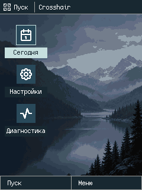
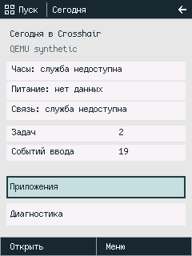

# Wave007.1 — Pocket PC Desktop Refinement

16.10.2026; принятая база [`bcc3fe9`](https://github.com/NaveLIL/Crosshair/commit/bcc3fe9f385be3686db980197665811968b1398c), технически принятый [Wave007](WAVE_007.md). Desktop переработан в рабочее пространство Pocket PC по [утверждённому reference](../docs/UI_DESIGN_SYSTEM.md#approved-visual-reference-for-crosshair-shell-01). Шесть больших плиток заменены обоями, тремя небольшими действующими ярлыками и компактной системной навигацией. Каталог встроенных приложений остаётся в Launcher; Today — отдельный информативный экран. Пользователь может выбирать мышью или полностью управлять интерфейсом клавиатурой.

**Реализовано и проверено в ARM TCG:** полный `scripts/test-wave007-1.sh` завершён exit0. Статус исполнения и окончательные размеры фиксирует [validation](wave007-1/validation.json); сырые ARM pixels и host replay сохраняются отдельно. Физический PDA2k в этой волне не запускался.

## Представление и навигация

| Элемент | Реальное поведение |
|---|---|
| Desktop | Обои240×320, верхняя панель24px, рабочая область y24..296, нижние softkeys24px; три ярлыка Today/Settings/Diagnostics вдоль левого края |
| Пуск | Top-left hit region x0..58/y0..24 либо F1/Desktop left softkey открывает Launcher; каталог не занимает рабочую область |
| Launcher | Четыре существующих builtin-экрана, фильтр16 Unicode scalars, сохраняемые query/selection, контекстное меню |
| Today | Настоящие kernel task/event observations и честные unavailable states для часов, питания и связи; кнопки Launcher/Diagnostics |
| Приложения | About, Diagnostics, Settings прежнего Shell process; theme/reset dialog действительно меняют volatile UI state |
| Указатель | Один tap активирует hit target; пустая рабочая область ничего не запускает; меню/диалог поглощают tap без прохода к элементу под ними |
| Клавиатура | Стрелки, Select, Back, Home, Menu, softkeys и screen switch сохраняют доступ ко всем действиям; mouse не является обязательным маршрутом |

[Общая геометрия](../shell/src/geometry.rs) использует half-open rectangles и задаёт границы и для композиции, и для hit-testing. Ярлыки имеют небольшие72×58 active areas с24px Tabler icon и контрастной подписью; фон между ними остаётся рабочей областью. Search/row/Back/softkey/menu/dialog используют те же проверенные логические действия. Имена новых приложений, файловая система, dynamic loader и универсальный оконный менеджер не добавлены. [Навигация](../docs/SHELL_NAVIGATION.md), [архитектура](../docs/SHELL_ARCHITECTURE.md), [статусы экранов](../docs/UI_SCREENS.md).




[Launcher PNG](wave007-1/frames/pointer/step-12.png), [About PNG](wave007-1/frames/pointer/step-13.png), [system menu PNG](wave007-1/frames/pointer/step-24.png), [Settings/night PNG](wave007-1/frames/pointer/step-03.png), [confirmation dialog PNG](wave007-1/frames/pointer/step-04.png). Это захваты гостевого framebuffer240×320, совпавшие с настоящей QEMU console и host oracle, не фотография физического LCD.

## Обои и стоимость композиции

[Исходный пейзаж](../shell/assets/wallpaper/crosshair-mist-source.png) создан встроенным imagegen; [точный prompt](../shell/assets/wallpaper/PROMPT.txt) и [provenance](../shell/assets/wallpaper/PROVENANCE.json) сохранены. Reference задаёт художественное направление; не используется как изображение с готовыми кнопками. Tabler MIT и Cozette сохраняют прежние notices.

[Генератор](../shell/tools/generate_wallpaper.py) на этапе сборки уменьшает источник до240×320, quantizes16 colors без dithering, переводит palette в RGB565 и создаёт row-RLE. Один byte: high4bits=`run_length-1` (1..16), low4bits=`palette_index` (0..15).321 u16 offsets позволяют сразу перейти к нужной строке; вторая маленькая palette задаёт night theme. В runtime нет PNG/SVG parser, heap allocation, expanded row buffer или второго framebuffer. Safe decoder пишет clipped runs непосредственно в прежний `Surface`.

| Read-only ресурс | Bytes |
|---|---:|
| Row-RLE packets |14827|
|321 row offsets |642|
|Classic/Night RGB565 palettes |64|
|**Всего wallpaper payload** |**15533**|
| Прежние Tabler masks |2196|

В actual User ELF palette находится по VA`010079a4`/PA`a04079a4`, row table — VA`010079e4`/PA`a04079e4`, RLE — VA`01007c66`/PA`a0407c66`; прежние Tabler masks — VA`01007110`/PA`a0407110`. Collector находит каждый полный byte pool ровно один раз внутри RX/RO load segment и сверяет его с generated source. Эти VA/PA относятся только к synthetic гостю.

Обычный `--check` stdlib проверяет source/prompt/generator/generated bindings и корректность RLE. Полная `--regenerate-check` использует pinned Pillow12.3.0 (те же hash-pinned dependencies, что подготовлены для Tabler). Пять отдельных tests проверяют malformed/truncated rows, offsets, ROM budget, source paths и binding mismatches. [Полный asset contract](../docs/UI_ASSET_SYSTEM.md#wave0071-static-wallpaper).

Full Desktop entry/theme/reentry декодирует только рабочую область; непрозрачные workspace/top/bottom полностью покрывают framebuffer, лишний предварительный full clear удалён. При движении focus восстанавливаются только old/new shortcut regions. Desktop menu open/selection рисует overlay и softkeys поверх уже готового фона, dismissal восстанавливает bounded covered union. Без видимых изменений композиция не запускается. Tests сравнивают incremental result с новой полной композицией byte-for-byte.

`RenderStats` — восемь u32: packets decoded, pixels decoded, wallpaper pixels written, runs written, dirty rectangles, dirty union area, full-composition flag, rendered flag. Это software work/coverage, **не полное число pixel stores**, CPU cycles, physical latency или backend transfer bytes. Наблюдение копируется в собственный User symbol `SHELL_RENDER_METRICS`, не расширяя kernel syscall ABI.

| Наблюдение ARM | RLE packets | Decoded pixels | Wallpaper writes | Dirty area |
|---|---:|---:|---:|---:|
| Initial Desktop |12724|65280|65280|76800|
| Перемещение focus между ярлыками |1461|9972|8352|8352|
| Открытие Desktop menu |0|0|0|45936|
| Tap пустой Desktop/About |0|0|0|0|

Смена фокуса затрагивает10.875% framebuffer и12.7941% workspace background writes; это экономия композиции. **Старый Present всё ещё публикует153600B полного кадра** на каждый render. User adapter объединяет несколько Surface dirty callbacks в один SVC Present: одна полная публикация уже покрывает все dirty regions. Kernel broker и его проверка размера/указателя/прав не менялись. В этой волне нет обещания ускорения физического ATI или сокращения его transfer cost.

## Pointer adapter и граница ARM

[AppKit frontend](../tools/crosshair_gui.swift) использует одну aspect-fit rectangle для blit и обратного преобразования mouse coordinates. Window points переводятся в top-left logical240×320, с half-open bounds; letterbox/outside/NaN отклоняются. Retina backing scale не подставляется вместо logical coordinates. Frontend не выполняет hit-testing Shell и не рисует элементы управления.

Существующая QEMU FIFO разрешает logical keys и Unicode, отвергая новый tag9. Поэтому synthetic tap передаётся как tag8/scalar `0xF0000+(y<<8)+x`, wire=`0x08000000|scalar`. Допустимы x0..239/y0..319; девятый бит Y сохраняется. Host резервирует весь supplementary range `F0000..10FFFF` от обычного text input. [User decoder](../src/shell_user.rs) выделяет coordinates до TextInput; Shell отклоняет недопустимые координаты без UI action/state mutation. Kernel транспорт может учесть такое доставленное слово; его delivery count и UI processed count различаются намеренно.

Маршрут: native `mouseDown` → bounded host input adapter → прежняя synthetic FIFO → прежняя kernel queue/WaitEvent → настоящий ARM User Shell → shared hit-testing → RGB565 → проверенный Present → QEMU console → native blit. Это experimental emulator convention, **не TSC2200/Blue Angel physical driver**. Ядро, scheduler, MMU, SVC role checks и QEMU model не переписаны. Collector проверяет actual kernel/vector/Busy ELF load bytes отдельно от изменённого embedded User payload.

## Проверки и артефакты

`scripts/test-wave007-1.sh` запускает всю цепочку Wave001–Wave007, затем новые pointer/cost tests и native mixed-input window. Старые reports/evidence не переписываются; Desktop keyboard trace адаптирован к трём shortcuts и Start вместо шести плиток, прежние переходы/guards/reset/burst/fault/role checks сохранены.

| Проверка | Подтверждённый результат |
|---|---|
| Host Shell |20 Rust tests: state/navigation/focus/search/menu/dialog/partial-vs-full/canaries, Tabler и wallpaper bounds |
| Assets |6 Tabler SVG tests +5 wallpaper corruption/binding tests; оба pinned generators rerun |
| Retained Shell ARM |4 boots,140 admitted events,47 host/ARM/QEMU pixel comparisons; reset/overflow/Busy fault/System Idle/role denial |
| Новые pointer/keyboard ARM |3 boots,56 delivered/52 UI events,34 pixel comparisons; pointer38 words/34 UI events, keyboard14, reset-burst4 |
| Bounds |4 transported invalid coordinates не меняют UI; model rejects tag9/surrogate/invalid control payload |
| Native input |Прежние pipe batching/Unicode/keyboard window плюс7 настоящих mixed NSEvents: mouseDown/up, Escape, кириллическая О, Enter, Home; ARM screens Today→Desktop→Launcher→Launcher→About→Launcher→Desktop |

В explicit window-test режимах собственные scheduled NSEvents помечены зарегистрированными type/integer-timestamp/keycode signatures. Приложение действительно пропускает их через NSApp/window/first-responder routing; намеренно добавленный незарегистрированный input проверяет изоляцию автоматического сценария от постороннего ввода. Тестовые окна не активируют приложение поверх текущего. Обычный interactive запуск принимает свободный input и активирует своё окно; test filter и автозакрытие там отключены.

Указатель проверяет реальные элементы Settings/theme/reset/cancel, Start/Launcher/About/Back, Today/Diagnostics, menu/outside dismissal, последний pixel239/319 и быстрые mixed inputs. Отдельный keyboard-only путь выполняет те же настройки. Фактические snapshots и выбранные PNG/raw565 совпадают с host replay. Costs читаются из ARM RAM после WaitEvent в стабильных точках: для последовательных действий — после каждого, для burst — initial/final, без придуманных промежуточных samples. UART сам по себе не выбирает PASS.

Основные PNG и raw RGB565 находятся в [frames](wave007-1/frames/); [полный журнал](wave007-1/all-tests.log), [pointer protocol](wave007-1/pointer/result.json), [retained Shell](wave007-1/shell/result.json), [validation](wave007-1/validation.json). Full detailed QTest memory protocols/ELF/BIN остаются в ignored `target/artifacts`; публичные копии нормализуют только host paths/hostnames.

## Память и границы результата

Источники окончательных размеров: actual [User ELF manifest](wave007-1/user-image/user-image.json), [kernel manifest](wave007-1/image/image.json), [ARM type sizes](wave007-1/user-image/type-sizes.txt) и [validation](wave007-1/validation.json). Все адреса — guest VA/PA synthetic display-test, не карта физического PDA2k.

| Allocation / объект | Bytes |
|---|---:|
| Kernel extent, прежние stacks/tables/Idle |84552|
| Shell71 mapped pages: code64KiB/data188KiB/stack32KiB |290816|
| Busy code/data/stack |12288|
| Low vectors |64|
| **Mapped working reservations** |**387720**|
| Два unmapped guard spans дополнительно |8192|
| Единственный pixels / guarded framebuffer |153600/153728|
| ARM Shell / Surface |228/88|
| RenderStats / новый User observation |32/32|
| User BSS (в прежней data reservation) |162176|
| User initialized code+rodata / запас до64KiB limit |49568/15968|
| Kernel flat BIN / debug ELF на диске |4211104/1267096|
| User flat BIN / debug ELF на диске |49568/1298392|

User BSS увеличен с162144 до162176B (+32B observation), Shell state — с196 до228B (+32B, RenderStats и dirty mask в прежней stack reservation). Резервы отображённой RAM не выросли. User initialized code+rodata вырос с25736 до49568B (+23832B);15533B этой дельты составляют wallpaper payload, остальное — изменения Shell/input/render code и alignment. Baseline сравнения сохранён в accepted Wave007 manifest, а collector связывает оба значения с ELF hashes. Palette/RLE/offsets находятся в RO allocation, decoder не хранит persistent row/pixel buffer. Это не zero-RAM claim для scalar call frames или всех новых Shell fields. Linker code limit64KiB сохранён; flat gaps и debug metadata не приравниваются к working RAM.

ARM type-size probe подтвердил Shell228/Surface88/Snapshot64/RuntimeInfo48/RenderStats32/DrawStats16/Framebuffer153728B. Его User ELF SHA совпал с реально испытанным `4a32d42dbd6857c9498835f4d64575d46d6792f93a6839dc14bc87e326ce75c0`. Source/kernel/vector/Busy load-byte проверки и сохранность старых reports отделены от изменённого embedded User payload. Это bounded prototype accounting, не worst-case stack measurement и не оценка всей128MiB synthetic RAM.

## Воспроизведение и следующий шаг

```sh
scripts/run-crosshair-gui.sh
# Mouse tap и клавиатура работают в одной ARM session; close/Cmd-Q завершает её.
mkdir -p target/artifacts/wave007-1
set -o pipefail
scripts/test-wave007-1.sh 2>&1 | tee target/artifacts/wave007-1/all-tests.log
python3 tools/collect_wave007_1_evidence.py --help
scripts/pack-repomix.sh
scripts/pack-repomix.sh --check-only
```

Остаются неизвестными physical LCD/touch behavior, performance/cache/DMA на PXA263 и worst-case stack usage. Нет новых приложений, filesystem, persistence, clocks, battery/GSM services, stylus calibration или общего window manager. Следующий конкретный шаг — вынести About в отдельную User-задачу через ограниченный application/display lifecycle, сохранив нынешние keyboard/pointer/pixel/preemption regressions.
