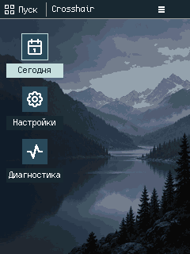
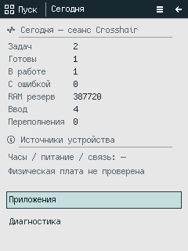

# Wave007.2 — Hardware-First UX & Adaptive Pocket PC Shell

16.10.2026. Принятая база — [`4cbb785`](https://github.com/NaveLIL/Crosshair/commit/4cbb78509ca1188e7ae4bf7703702128184b16f6), [Wave007.1](WAVE_007_1.md). Полный `scripts/test-wave007-2.sh` завершился **exit 0**. Это функциональная переработка настоящего ARM User Shell: общий renderer, ядро, MMU, scheduler и synthetic QEMU model сохранены. Физический PDA2k не запускался, заводская ROM не изменялась.

## Результат и аудит

На прежних ARM кадрах Desktop дублировал «Пуск» сверху и снизу; обязательные панели занимали 48 из 320 строк. Today повторял длинные unavailable states в больших блоках, About выделял 38px под короткую пару значений. Это проблемы композиции и системной политики. Палитра, framebuffer, шрифт и графический движок замены не требовали.

Теперь Desktop сохраняет горные обои, три небольших действующих ярлыка и один постоянный Start. Нижней полосы нет. Today группирует реальные kernel observations в компактные строки с небольшими значками, разделителями и inline actions; недоступные часы/питание/связь обозначены одной строкой. About/Diagnostics используют общие key-value rows, section headings и настоящую ограниченную прокрутку. Нет фиктивных встреч, батареи, времени, GSM или новых приложений.

| Режим | Постоянный chrome | Content viewport | Реальная демонстрация |
|---|---|---|---|
| Standard | Верхние 24px | 240×296, y24..320 | Desktop/Today/Launcher/Settings, обычные About/Diagnostics |
| Compact | Верхние 16px | 240×304, y16..320 | Те же About/Diagnostics с компактным заголовком |
| Immersive | Нет зарезервированной полосы | 240×320 | Те же встроенные экраны; маленький 16×16 Menu handle поверх содержимого |

В сравнении с прежними 272 content rows Standard возвращает 24 строки, Compact — 32, Immersive — 48. Это один `ChromeMode`/viewport contract на прежнем Surface. Режимы не являются отдельными приложениями или графическими движками. Shell сохраняет исключительную обработку Home/Start/Back/Task Switch/SystemPanel; ни один режим не убирает клавиатурный или экранный путь возврата.

Временная панель содержит реальные системные команды и доступные режимы. Back/Escape закрывает её без изменения underlying focus/query/history/mode. Меню поглощает outside tap без передачи нажатия элементу под ним; outside-dialog tap ничего не подтверждает. Контекст Launcher доступен и через F2, и через измеренное удержание стилуса. [Политика и API](../docs/ADAPTIVE_SHELL.md), [навигация](../docs/SHELL_NAVIGATION.md), [дизайн-система](../docs/UI_DESIGN_SYSTEM.md).

## Настоящие кадры 240×320




[Launcher](wave007-2/frames/pointer/step-12.png), [About / Standard](wave007-2/frames/adaptive-reset/step-02.png), [временная панель](wave007-2/frames/adaptive-reset/step-03.png), [Compact](wave007-2/frames/adaptive-reset/step-04.png), [Immersive](wave007-2/frames/adaptive-reset/step-07.png). PNG получены из гостевого RGB565 и совпали с QEMU console и host oracle. Это не host UI prototype или предварительно записанная анимация.

## Аппаратная логика и pointer contract

[HARDWARE_FIRST_UX](../docs/HARDWARE_FIRST_UX.md) разделяет физические сигналы, системные семантические действия, app context и пользовательские bindings. Источники — HTC PH20B FCC exhibit460916, страницы 8/9/56/150, и закреплённый исторический Blue Angel kernel source. В документе приведены URL, хеши, точные локаторы и статус каждого вывода. Имена кнопок подтверждены исторической документацией; предложенные Crosshair mappings и неизвестные электрические сигналы отделены от них. Windows button IDs, Linux key symbols и Mac keyCode не выданы за PDA scan codes. GPL driver code не переносился в MIT Shell.

Mac adapter передаёт отдельные Press/Move/Release/Cancel и key Press/Repeat/Release в прежнюю FIFO, затем в настоящий ARM Shell. Press захватывает target без запуска; eligible Release вызывает один Tap. Выход за target отменяет активацию даже после возврата. Смена view, клавиатурная навигация, Cancel и известная потеря ввода снимают capture; stale Release не активирует новый элемент. Длительность удержания измеряется `ProcessInfo.systemUptime`, а не тестовым NSEvent timestamp или числом циклов; порог 600 мс проверяет общий Shell. Hold подавляет последующий Tap. Это экспериментальный источник, не TSC2200 driver.

Модель по-прежнему принимает tags1..7 и tag8 Unicode. Atomic scalar blocks Release/Move/Press/legacy Tap находятся на базах `90000/B0000/D0000/F0000` с добавлением `(y<<8)+x`; это emulator-reserved transport, исключённый из обычного текста. Полный контракт, отмена и ограничения описаны в [ADAPTIVE_SHELL](../docs/ADAPTIVE_SHELL.md#shared-wire-interpretation-and-failure-policy). User и host oracle вызывают один `Action::from_wire`. Kernel event service/queue capacity не изменялись.

Первый Press исполняет логическую клавишу один раз до Release. Repeat разрешён только для уже удерживаемых направлений; повтор Select/Home/Start/Panel не запускает команды заново. При реальном росте overflow counter или потере ранее валидного input source общий Shell сбрасывает capture/held state. Последующий принятый Press может начать новый жест; гарантированная доставка при произвольной скорости и восстановление неизвестного физического драйвера не заявляются. Home/Panel остаются независимыми путями управления.

## Проверки

| Проверка | Итог окончательного прогона |
|---|---|
| Прежняя цепочка | Wave001–Wave007.1: boot/panic/parser, PXA/E2A/E2B, UI, display, 24 security cases / 48 boots, 8 task cases / 16 boots |
| Общий UI | 27 Rust tests, включая 3 новых PDA component tests; прежние pixel goldens, 20000 property operations и ARM compile сохранены |
| Shell и ресурсы | 27 Rust tests; 6 SVG tests, 5 wallpaper tests, оба pinned regenerate-check |
| Retained Shell ARM | 4 boots, 140 delivered events, 47 host/ARM/QEMU pixel comparisons; reset, bursts, overflow, Busy fault, Idle recovery, role/ABI checks |
| Retained pointer/keyboard ARM | 3 boots, 56 delivered / 52 UI events, 34 pixel comparisons; прежние функциональные маршруты, bounds/malformed input и cost checks |
| Новые hardware-first ARM | 2 boots, 75 delivered / 73 UI events, 77 state/UX/cost observations, 24 pixel comparisons |
| Настоящее окно AppKit | 8 key edges, 13 mixed pointer/key/text records, отдельные 29 records: drag/cancel, actual measured hold, repeat, три режима и F4 Home |

В новых ARM сценариях проверены Desktop без нижних targets, запуск и возврат, аппаратная логическая команда и pointer путь, временная панель, Compact/Immersive/Standard, focus/history/scroll, быстрый ввод, stationary/moved/orphan/short hold, source cancel, invalid Move, настоящий queue overflow при захвате и held key. Дополнительные rich Press/Release checks закрывают outside panel без fall-through, оставляют dialog modal и вызывают контекст Launcher удержанием. Каждый boot сохраняет framebuffer guards, live MMU tables, User context и прогресс независимой Busy-задачи; Waiting не превращается в polling/render loop.

Проверены все 16 Snapshot, 20 UX и 8 RenderStats words в соответствующих новых trace observations; captured pixels сравниваются целиком, а не только по хешу. Legacy trace intents адаптированы к отсутствию footer и более плотным Today actions; прежние reset/fault/isolation/rejection проверки сохранены. Тестовые AppKit окна принимают только зарегистрированные NSEvents и отключают opening animation для точных synthetic coordinates. Обычный сеанс принимает свободный ввод и остаётся открытым до закрытия/⌘Q.

Источники доказательств: [полный журнал](wave007-2/all-tests.log), [validation](wave007-2/validation.json), [retained Shell](wave007-2/shell/result.json), [pointer](wave007-2/pointer/result.json), [adaptive](wave007-2/adaptive/result.json), [frames](wave007-2/frames/). Подробные QTest memory protocols и ELF/BIN остаются в ignored `target/artifacts`; публичные text copies нормализуют host paths. Прежние 900 report/evidence files сохранены byte-for-byte; 20 прежних flat images и 134 защищённых source files проверяются отдельно. В `ui/src/lib.rs` разрешена ровно строка экспорта нового `pda` module; исходный renderer не изменён.

## Память и размер кода

Источник — actual ELF segments/symbol sizes, [User manifest](wave007-2/user-image/user-image.json), [kernel manifest](wave007-2/image/image.json), [ARM type probe](wave007-2/user-image/type-sizes.txt) и validation. Все адреса относятся к synthetic guest, не физическому PDA2k.

| Allocation / объект | Wave007.1 | Wave007.2 | Изменение |
|---|---:|---:|---:|
| User code + rodata / flat bytes |49568|57369|+7801|
| Запас до прежнего 64KiB code limit |15968|8167|−7801|
| User BSS |162176|169424|+7248|
| ARM Shell state |228|296|+68|
| Surface |88|88|0|
| Единственный pixels / guarded framebuffer |153600 / 153728|153600 / 153728|0|
| Wallpaper RO / Tabler masks RO |15533 / 2196|15533 / 2196|0|
| Kernel extent |84552|84552|0|
| Shell mapped code/data/stack reservation |290816|290816|0|
| Все mapped working reservations с Busy/vectors |387720|387720|0|

Дополнительные BSS bytes — UX observation80 + UX ring5120 + render ring2048 = 7248. После них в прежней 188KiB data reservation остаётся 23088 байт; нового framebuffer/heap/row decode buffer нет. Shell state вырос на 68 байт внутри прежней stack reservation32KiB. Snapshot64, RuntimeInfo48, RenderStats32, DrawStats16 и UxSnapshot80 подтверждены ARM type probe. Это не измерение peak stack usage и не утверждение о нулевой дополнительной занятой RAM.

Kernel RX5180B, Busy RX524B, vectors64B и kernel RW reservation совпали с accepted ELF load bytes. Изменился embedded User payload; поэтому whole kernel ELF hash закономерно другой. Type probe воспроизвёл именно испытанный User ELF SHA256 `43fe3fea7c50d525faac28a3d2ba7cf1e118c01079d6613d6f7003a52a718496`.

## Измеренная стоимость обновления

`RenderStats` измеряет wallpaper decode/write work и dirty area, а не все pixel stores, CPU cycles или физическую latency. Значения ниже прочитаны из настоящей ARM RAM и сверены с host.

| Операция | Wave007.1 | Wave007.2 |
|---|---|---|
| Initial Desktop |12724 RLE packets;65280 wallpaper pixels;76800 dirty pixels|14297 packets;71040 wallpaper pixels;76800 dirty pixels|
| Focus между соседними ярлыками |8352 wallpaper/dirty pixels|8352 wallpaper/dirty pixels|
| Desktop system menu |0 wallpaper;45936 dirty pixels|0 wallpaper;40176 dirty pixels|
| Dismiss Desktop menu |44880 wallpaper;50640 dirty pixels|53240 wallpaper/dirty pixels|
| Пустой Desktop / About |0 render work|0 render work|

Расширенный Desktop декодирует на 5760 фоновых пикселей больше при полном входе, поскольку нижние 24 строки теперь принадлежат workspace. Focus остаётся частичным; menu больше не перерисовывает footer. Dismiss использует общий консервативный restore rectangle для меню/панелей и ярлыков; его стоимость выросла, как показано в таблице. Это ограниченная частичная композиция, без утверждения о минимально возможном числе затронутых пикселей. В matched свежем запуске Today прежний atomic Tap требовал одну запись и один render; новый Press/Release требует две записи и два render: pressed feedback4176 dirty pixels, затем Today76800. Действие вызывается один раз. При прежнем full Present это две публикации по153600B вместо одной: явная цена полноценного pointer lifecycle.

В новом `phases` boot 43 records дали 27 rendered / 16 no-render observations; `adaptive-reset` — 32 records, 22 / 10. Clamped Desktop repeat и Release дали нулевые render counters. Игнорируемый Select Repeat на Diagnostics может обновить реальные видимые counters; отсутствие новой команды не означает отсутствие полезного render. Hit testing статически ограничен 8 menu rows, 4 apps или 3 shortcuts; это bound по source, не измеренный instruction count. Guest cycles/instructions, FPS и physical screen-update cost не измерялись. Общие компоненты не объявляются автоматическим ускорением.

## Воспроизведение и границы

Для независимого сравнения коллектору нужна сохранённая принятая Wave007.1 ELF: `target/artifacts/wave007-2/baseline/accepted-crosshair-shell.elf`, SHA256 `3770ee3aae11baef7c96ae4b7739ebfe0aa1e33ac05720c001f4a6b16d62f207`. Сохранить её до пересборки текущих artifacts; другой путь передаётся через `--accepted-kernel`. Этот собственный executable остаётся локальным. На чистом checkout сначала требуется воспроизвести accepted base закреплённым toolchain и проверить хеш либо предоставить сохранённый ELF; без него коллектор не ослабляет проверку до одного журнала.

```bash
scripts/run-crosshair-gui.sh
# F1 Start, F4/Home Desktop, F10 Panel, F2 context, F3 switch; при необходимости Fn.
# Mouse Press/Release; stationary hold >=600ms. Закрытие окна/⌘Q завершает QEMU.
mkdir -p target/artifacts/wave007-2
scripts/test-wave007-2.sh > target/artifacts/wave007-2/all-tests.log 2>&1
source scripts/shell-env.sh
cargo rustc --release --locked --no-default-features --features shell-user \
  --bin crosshair-shell-user -- -Zprint-type-sizes \
  > target/artifacts/shell/user-image/type-sizes.txt 2>&1
crosshair_llvm_tools="$(rustc --print sysroot)/lib/rustlib/$(rustc -vV | sed -n 's/^host: //p')/bin"
crosshair_qemu_cache="$(dirname "$(dirname "$QEMU_DISPLAY_TEST")")"
python3 tools/collect_wave007_2_evidence.py --llvm "$crosshair_llvm_tools" --qemu-cache "$crosshair_qemu_cache"
python3 tools/collect_wave007_2_evidence.py --llvm "$crosshair_llvm_tools" --qemu-cache "$crosshair_qemu_cache" --check-only
scripts/pack-repomix.sh
scripts/pack-repomix.sh --check-only
```

[BUILDING](../BUILDING.md) содержит зависимости и отдельные headless/native commands. [HARDWARE_FIRST_UX](../docs/HARDWARE_FIRST_UX.md) задаёт будущие Music/Calculator/Notes/Files/Terminal/Reader/Clipboard profiles и bounded text/ten-record clipboard contract. Их приложения, Clipboard Broker, filesystem, loader, compositor и физические input/display drivers в этой волне не реализуются. Неизвестны electrical scan codes/calibration, поведение ATI/PXA263, cache/DMA, physical performance и worst-case stack. Wave008 не начат.

Следующий конкретный шаг — ручной проход в обычном Mac окне: F1 → Enter → F10, смена режима стилусом, Escape и F4; сверить удобство на собственном MacBook с сохранёнными ARM кадрами.
